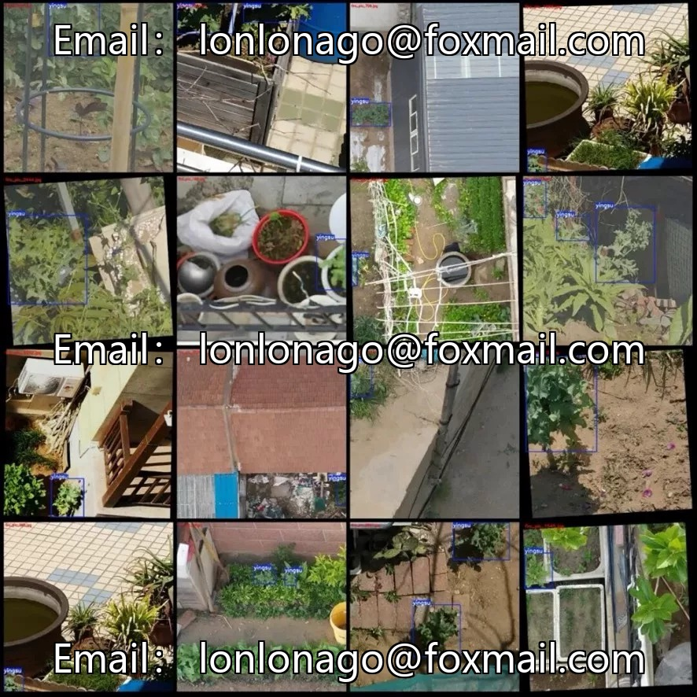
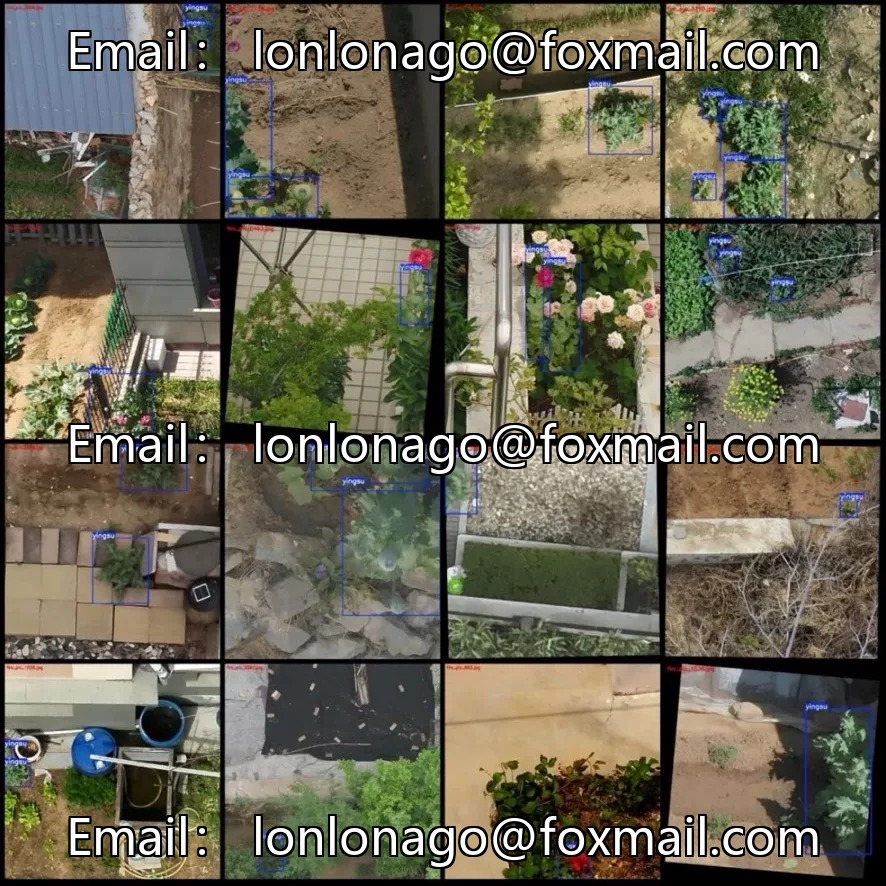
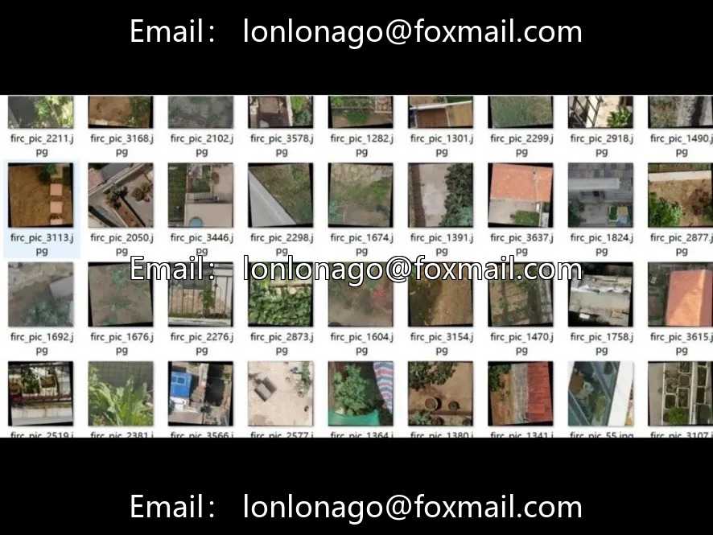

# Drone aerial photography dataset for poppy detection

## Body

Drone aerial photography dataset for poppy detection, 3648 images, 1 category (yingsu/poppy), dual format annotation with VOC+YOLO, labeled by labelImg tool with bounding box annotations, total 6066 bounding boxes, average 1.66 plants/image

Data with multiple resolutions (988x988, 1280x1280, etc.), including data augmentation, approximately half are rotation augmented images, please note the distinction. Each image is labeled, covering all 3648 images. The dataset does not pre-divide training/validation/test sets; it is recommended to divide them yourself at a ratio of 8:1:1, grouping by source images to avoid data leakage.

Suitable for drug prohibition patrols, unauthorized drone cultivation monitoring, and detection of specific plant targets. It is recommended to use a unified resizing strategy (such as 640x640 or larger).

Virtual materials, once sold, are non-refundable.
Interested friends, click "I want" to proceed.

## Images

## Payment

Here is a pay link on Stripe ( https://buy.stripe.com/3cs8yP7sY87d0vu9AB ). Please contact me lonlonago@foxmail.com after funding $89, and I will send you a complete data files , thank you!

